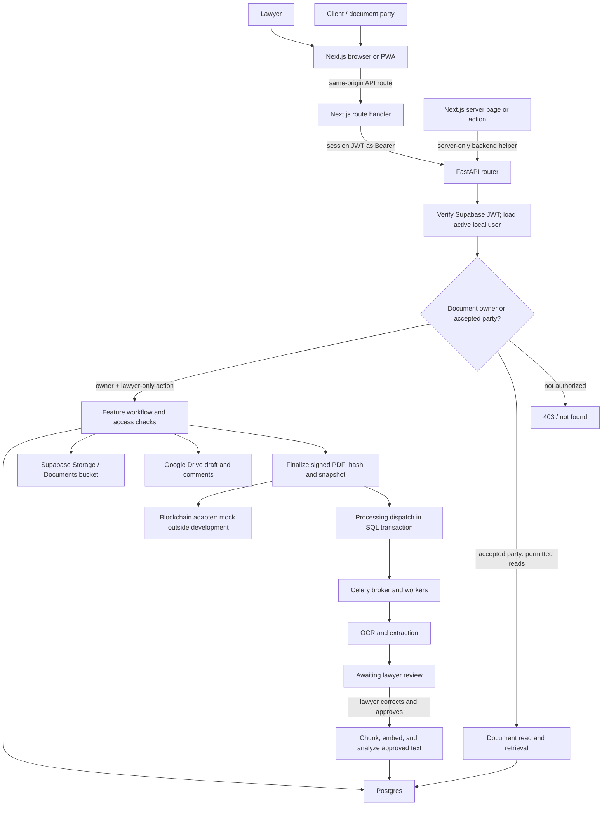

# LexChain architecture

LexChain is a two-repository system: this repository contains the Next.js web application and PWA; the separate `lexchain-backend` repository contains the FastAPI service. The former Expo application is preserved at `codex/backup-expo-before-web-pwa-2026-09-09`; it is not part of the active workspace.

For lawyer and participant journeys paired with backend endpoints, see the [user-flow architecture](USER-FLOW-ARCHITECTURE.md) and [use-case overview](lexchain-usecase-flow.md). The user-flow guide distinguishes declared backend behavior, frontend callers, mock differences, and runtime verification limits.

## Whole-system flow

**Evidence basis.** Backend source was checked at commit `05f99cfdd5047bd8214fb328fb963b09704e80a2`. Backend paths below are relative to the separate backend repository. Source establishes the route and workflow wiring described here; it does not show which provider, storage policy, or worker configuration is enabled in a deployment.



### Backend boundaries and request authorization

The FastAPI app composes feature routers in `backend/app/main.py`; document routes live under `/documents` and hand work to feature workflows, while `backend/app/infrastructure/` supplies database, security, storage, queue, Google, NLP, and blockchain adapters. This is a feature-oriented layout; it is not evidence of a separately deployed service per feature. [Source: `backend/app/main.py:12–27,72,169–177`; `backend/app/features/documents/router.py:59,734`.]

`POST /auth/signin` delegates password sign-in to Supabase Auth, synchronizes the identity to the local user record, and returns access and refresh tokens. Protected requests validate the access JWT against Supabase JWKS (signature, expiry, and `authenticated` audience), resolve its `sub` to an active local user, then use the local `users.role` for backend role checks. Document authorization is an additional, per-record check; a lawyer role does not grant write access to every document. [Source: `backend/app/features/auth/router.py:21,73–121`; `backend/app/features/auth/service.py:192–305`; `backend/app/infrastructure/security/jwt_handler.py:50–91`; `backend/app/infrastructure/security/dependencies.py:66–149`; `backend/app/features/documents/access.py:41–57`.]

In backend terms, a “client” is an accepted `DocumentParty`, not a global user role. The lawyer who owns the record invites an existing account; a pending invitation grants no document access. An accepted party can view the document, but the document API reserves mutations and review/finalization actions for the owner or an authorized lawyer workflow. While a working draft is being prepared, accepted clients get Google Docs commenter access; when the draft is marked ready, non-owners become read-only. The UI can reflect these permissions, but the backend rechecks them on requests. [Source: `backend/app/features/documents/workflow/sharing.py:48–119,156–196`; `backend/app/features/documents/repository.py:140–153`; `backend/app/features/documents/access.py:41–57,67–82`; `backend/app/features/documents/workflow/drafting.py:45–53,72–122`.]

### Lawyer and client document flow

There are two intake paths. For lawyer-led preparation, the lawyer creates a document, optionally creates a Google Docs working draft, invites parties, and marks the draft ready. That Google file is a collaboration surface in the lawyer’s Drive; the signed PDF attached later is the record used for filing and verification. Alternatively, a lawyer can upload an already-signed PDF directly into a register book. The document router exposes these operations, including `POST /documents/{id}/draft`, `POST /documents/{id}/ready`, `POST /documents/{id}/signed-copy`, `POST /documents/upload`, invitations/parties, `POST /documents/{id}/finalize`, `GET /documents/{id}/file`, `POST /documents/{id}/retry-processing`, and `GET /documents/{id}/verify`. [Source: `backend/app/features/documents/router.py:59,116–185,226–260,312–383,423–440,479–658,670–728,734–750`; `backend/app/features/documents/workflow/drafting.py:72–122`; `backend/app/features/documents/workflow/intake.py:79–206`.]

When attaching a signed PDF to a prepared record, the workspace lets the lawyer select a register book. Closed books require the paper register’s document and page numbers; an open book can allocate an entry or accept manually entered numbers. Direct signed-PDF upload also requires a book. [Source: frontend `src/features/documents/components/document-workspace.tsx:104–117,380–397`; backend `backend/app/features/documents/workflow/intake.py`, `backend/app/features/documents/router.py`.]

Finalization checks the stored signed-copy bytes against their recorded SHA-256, creates a snapshot, asks the selected blockchain provider to record the document hash, advances lifecycle metadata, and creates the extraction dispatch. The processing state is separate from the document lifecycle: finalization queues extraction; lawyer review corrects and approves OCR text; only then does enrichment chunk, embed, and analyze that approved text for search and document Q&A. The PDF hash used for integrity and the approved-text hash used for indexing are different values with different purposes. [Source: `backend/app/features/documents/workflow/finalization.py:42–108`; `backend/app/features/snapshot/service.py:26–46`; `backend/app/features/documents/dispatch.py:23–79`; `backend/app/workers/process_documents.py:35–152,155–236`; `backend/app/features/documents/extraction/service.py:183–229`; `backend/app/features/retrieval/service.py:23–58,92–181`.]

The dispatch row is written with the document state in SQL, then sent to the queue after commit; a relay retries stale pending dispatches. Celery tasks split extraction and enrichment into separate phases, and Celery Beat schedules the relay and other periodic work. A deployment therefore needs the broker, worker, and Beat processes configured and running for asynchronous status changes to complete. The source establishes this design, not the state of those processes in production. [Source: `backend/app/features/documents/models.py:417–450`; `backend/app/features/documents/dispatch.py:23–79`; `backend/app/celery_app.py:16–45`; `backend/app/workers/dispatch_pending.py:20–61`; `backend/app/celery_tasks/documents.py:25–63`.]

### Data and external systems

Postgres is accessed through async SQLAlchemy sessions and owns user, document, party, lifecycle, review, processing, and retrieval records. The backend storage adapter uses a `Documents` bucket and a server-held Supabase service-role client; its file-read flow resolves stored locators and can create short-lived signed URLs. This is evidence of source-level signed-URL handling, not proof of the deployed bucket policy: that policy was not inspected. The frontend does not own an authoritative copy of these records or files. [Source: `backend/app/infrastructure/database/sessions.py:21–69`; `backend/app/infrastructure/clients/supabase_storage.py:6–61,71–92`; `backend/app/features/documents/router.py:420–437`; `backend/app/features/chunks/models.py:14–56`; `backend/app/features/chunks/repository.py:40–56`.]

Google OAuth connections support Drive drafts and comment synchronization. Refresh tokens are stored encrypted; a separate picker-token operation returns a Google access token to the browser for the Google Picker flow, so “credentials stay server-side” has this explicit, scoped exception. OCR, embedding, LLM, Google, and draft adapters have configuration-selected real and mock implementations; source alone cannot establish which choices a deployment uses. [Source: `backend/app/features/google/service.py:140–180`; `backend/app/infrastructure/nlp/ocr/factory.py:11–44`; `backend/app/infrastructure/nlp/embeddings/factory.py:8–11`; `backend/app/infrastructure/nlp/llm/factory.py:6–20`; `backend/app/infrastructure/google/factory.py:6–14`; `backend/app/infrastructure/drafts/factory.py:6–14`.]

> **Important blockchain limit:** finalization calls the blockchain service, but the provider factory selects `MockBlockchainProvider` unless `ENVIRONMENT == "development"`. The repository therefore does not prove that a deployed environment anchors hashes on-chain. The Web3 adapter’s receipt and hash checks apply only when that adapter is selected. [Source: `backend/app/features/documents/workflow/finalization.py:42–108`; `backend/app/features/blockchain/dependencies.py:7–11`; `backend/app/features/blockchain/service.py:40–79`; `backend/app/infrastructure/blockchain/web3_provider.py:31–72`.]

### Contract and runtime evidence

The reviewed backend source defines `GET /documents/{document_id}/file`, which checks access and returns a short-lived signed URL, and `POST /documents/{document_id}/retry-processing`, which accepts only an owner’s failed document and resumes its failed processing phase without finalizing or anchoring again. The frontend OpenAPI file and generated TypeScript are snapshots that can lag backend source. These source paths do not prove deployed storage policy, provider selection, worker health, or successful authenticated requests; no live document journey was run for this review.

The frontend owns presentation, form and interaction state, same-origin route adapters, and its session-cookie handling; role hints affect display only. Browser requests normally use same-origin `/api` route handlers, with dedicated auth, signup, participant, admin, and file routes as well. The file route obtains an authorized, short-lived backend URL and streams the response; server-rendered pages and actions may call the server-only backend helper directly. FastAPI owns identity enforcement, per-document authorization, lifecycle rules, durable records, file access, processing, and provider calls. Frontend OpenAPI types are a snapshot and do not runtime-validate responses. For a user-by-user endpoint map, see the [user-flow architecture](USER-FLOW-ARCHITECTURE.md); read it alongside the source limits above.

## Ownership

| Location | Responsibility |
| --- | --- |
| `src/app/` | Next.js routes, layouts, metadata, API handlers, and manifest |
| `src/proxy.ts` | Request interception and session or legacy-route redirects |
| `src/features/` | Document, verification, access, office, account, authentication, admin, and portal behavior and views |
| `src/shared/components/` | Browser-safe reusable UI |
| `src/shared/api/` | Browser transport to same-origin routes and shared API helpers |
| `src/server/api/` | Server-only backend URL, credential, and request helpers |
| `src/config/` | Pure API configuration |
| `src/shared/types/` | Backend types and generated OpenAPI schema |
| `src/lib/mocks/` | Local mock fixtures and mock-mode helpers |
| `src/pwa/` | Production service-worker registration |
| `public/` | Static assets, PWA icons, service worker, and offline fallback |
| `scripts/`, `e2e/` | Contract maintenance and browser checks |

`src/app/` owns Next.js integration. `src/features/` owns domain behavior. Shared browser modules do not import features or server modules. Browser API calls use same-origin Next.js route handlers through feature API helpers or shared transport such as `src/shared/api/client.ts`. Several feature helpers call those handlers directly with `fetch`. Server-rendered views and server actions may use `src/server/api/backend.ts` directly. Keep server-only modules out of client bundles.

## API and type boundaries

### Feature entry points

Feature barrels use explicit named exports for symbols consumed outside their feature. Import public helpers from `@/features/<feature>`, reusable feature UI from its `components` entry point, and route views from its `pages` entry point. Admin management views have their own entry points, such as `@/features/admin/users`.

Internal modules keep direct implementation imports. Tests may also import implementations directly to exercise or mock a focused module. Keep server helpers in `server/index.ts` and server-rendered route views in `pages/server.ts`; never re-export them from a browser-safe entry point. Preserve direct lazy imports for PDF viewers and mock fixtures so barrels do not change when those modules load. The office `reports.ts` entry point keeps demo report generation separate from office settings.

Do not use `export *` or add an entry point without an outside consumer. The architecture script follows runtime imports and re-exports to prevent client modules from reaching server modules through a barrel.

Configure backend URLs with `API_URL` and `NEXT_PUBLIC_API_URL`; never hardcode credentials or backend URLs. Backend types are generated from `openapi-updated.json` into `src/shared/types/generated/schema.ts`:

```bash
OPENAPI_URL='http://localhost:8000/openapi.json' pnpm refresh:api-contract
git diff -- openapi-updated.json
pnpm generate:api-types
git diff -- src/shared/types/generated/schema.ts
```

Review the contract diff before generation. To generate from the checked-in contract without a network refresh, run only `pnpm generate:api-types`. Do not hand-edit the generated schema. Contract types describe declared backend behavior; they do not prove successful execution or validate every response at runtime.

## PWA and offline behavior

`src/app/manifest.ts` describes the installable app. `src/pwa/pwa-registration.tsx` registers `public/sw.js` only in production. The worker caches only `offline.html`, serves it only after a failed eligible navigation, and never caches API responses, authenticated pages, documents, uploads, tokens or user data. There is no offline mutation queue, background sync or forced reload.

## Verification and deployment

Run from the repository root:

```bash
pnpm install --frozen-lockfile
pnpm test
pnpm test:scripts
pnpm typecheck
pnpm lint
pnpm build
```

Run `node e2e/pwa.mjs` against `pnpm start` to check installation, cache behavior and offline fallback. Deployment uses root directory `.`, `pnpm install --frozen-lockfile`, and `pnpm build`. Hosting configuration, deployed CI, real backend flows and physical-device installation require separate verification.

## Rollback

Revert the specific migration commit that introduced a regression and rerun its checks. Do not restore the Expo archive wholesale. To inspect it separately:

```bash
git worktree add --detach ../LexChain-expo-archive codex/backup-expo-before-web-pwa-2026-09-09
```
