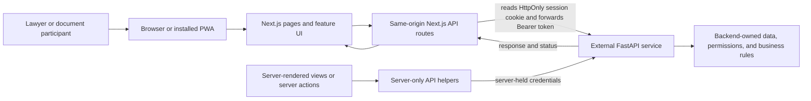
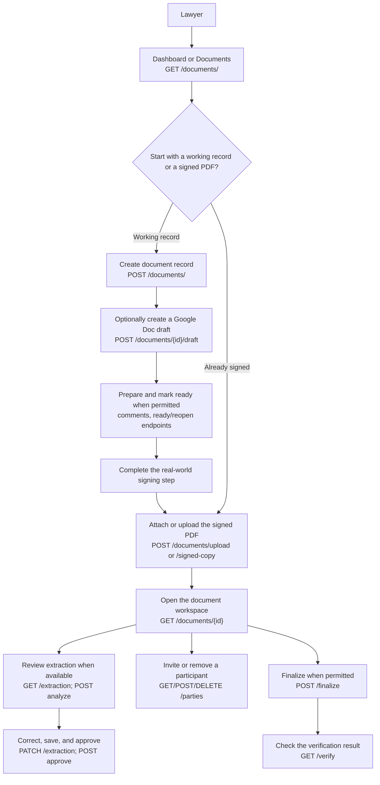
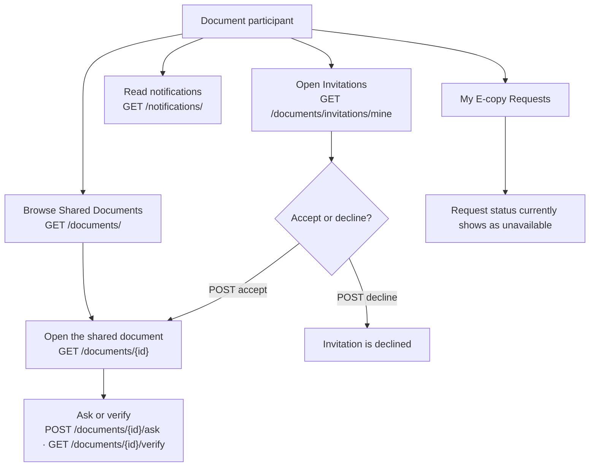

# Current understanding of LexChain architecture and user flows

_Reviewed 2026-10-10._ This note describes the active frontend in this checkout and the backend API contract available to it. It is a practical walkthrough, not proof that every documented operation is connected or available in a deployed environment.

## In brief

LexChain is a Next.js web application that can be installed as a PWA. It gives lawyers and document participants different portal navigation. The application sends authenticated requests to a separate FastAPI service. The frontend presents workflows and validates inputs at selected boundaries; the backend owns document records, persistence, authorization, lifecycle rules, processing, and verification.

## How a request moves through the system

Browser requests normally go to the LexChain origin first. The shared GET proxy is `/api/portal/proxy`; the mutation proxy handles POST, PUT, PATCH, and DELETE at `/api/portal/proxy-post`. Authentication, signup, participant access, and some administrative operations also use dedicated route handlers. Server-rendered pages and server actions can use server-only backend helpers directly.

After sign-in, the Next.js route stores the backend token in HttpOnly cookies. Browser JavaScript uses the same-origin routes and does not need to read the bearer token. A readable role hint helps select the right navigation, but it is not an authorization check. The backend remains responsible for deciding whether a request is allowed.

The backend URL is configured with `API_URL` or `NEXT_PUBLIC_API_URL`. The frontend does not own a second database or a second copy of the document lifecycle rules.

## Signing in and choosing a portal

1. A person signs in from `/login`. The browser posts to `/api/auth`, which forwards credentials to the backend sign-in operation.
2. The response establishes the local portal session cookies and includes the account role.
3. Lawyer-like roles (`lawyer`, `document_issuer`, `admin`, and `super_admin`) use the Lawyer navigation. Participant-like roles (`user` and `document_participant`) use the User navigation.
4. Lawyers land on `/portal/dashboard`; participants land on `/portal/documents`. Unsupported roles see an access-unavailable message.
5. Signing out calls the portal logout route. The server attempts backend sign-out and clears the local session cookies even if the backend cannot be reached.

These role mappings control the presentation. They do not replace backend authorization.

| User action | Frontend route | Backend endpoint |
|---|---|---|
| Sign in | `/login` → `/api/auth` | `POST /auth/signin` |
| Create an account | `/register` → `/api/portal/signup` | `POST /auth/signup` |
| Resend verification | Signup/verification UI → `/api/portal/resend-verification` | `POST /auth/resend-verification` |
| Load the account profile | Portal UI → `/api/portal/proxy` | `GET /users/`; sign-in response is the primary role source |
| Sign out | `/api/portal/logout` | `POST /auth/signout`, then local cookies are cleared |

## A lawyer’s document workflow

The lawyer’s portal navigation includes the dashboard, documents, books, categories, reports, user accounts, issuer invitations, audit logs, and office settings.

The route map below pairs user actions with the backend calls found in the current source. A call path in the frontend does not guarantee that the deployed backend succeeds for every record.

| Step | Frontend page/action | FastAPI endpoint(s) |
|---|---|---|
| Open dashboard and document list | `/portal/dashboard`, `/portal/documents` | `GET /documents/`; lawyer dashboard metrics also use `GET /admin/dashboard` |
| Create a working record | Documents → Create document draft | `POST /documents/` |
| Connect Google and create/select a working draft | `/portal/profile/account`, document workspace | `GET /google/connection`, `POST /google/connect`, `GET /google/picker-token`, `POST /documents/{document_id}/draft`; callback is redirect-driven |
| Read and sync draft comments | Document workspace | `GET /documents/{document_id}/comments`, `POST /documents/{document_id}/comments/sync` |
| Mark ready or reopen | Document workspace | `POST /documents/{document_id}/ready`, `POST /documents/{document_id}/reopen` |
| Upload a signed PDF to a book | `/portal/upload` | `GET /books/`, `POST /documents/upload` |
| Attach, replace, or review signed-copy history | Document workspace | `POST /documents/{document_id}/signed-copy`, `PUT /documents/{document_id}/signed-copy`, `GET /documents/{document_id}/signed-copies` |
| Read or rename a document | Document workspace | `GET /documents/{document_id}`, `PATCH /documents/{document_id}` |
| Review extracted text when available | `/portal/documents/{id}/review` | `GET /documents/{document_id}/extraction`, `POST /documents/{document_id}/extraction/analyze`, `PATCH /documents/{document_id}/extraction`, `POST /documents/{document_id}/extraction/approve` |
| Invite or remove a document participant | `/portal/documents/{id}/participants` | `GET /documents/{document_id}/parties`, `POST /documents/{document_id}/parties`, `DELETE /documents/{document_id}/parties/{party_user_id}` |
| Finalize and verify | Document workspace, `/portal/documents/{id}/verify` | `POST /documents/{document_id}/finalize`, `GET /documents/{document_id}/verify` |
| Search documents or ask about one | `/portal/search`, `/portal/documents/{id}/ask` | `POST /search`, `POST /documents/{document_id}/ask` |

The two entry paths are different: a Google Doc is an editable working draft, while a signed PDF is the legal copy filed in the document workflow. The draft panel describes the Google document as separate from the signed PDF. Uploading a signed PDF asks the lawyer for a title and book; closed books can also require paper register numbers.

The diagram lists available actions rather than asserting one fixed order. Extraction review, signing, and finalization depend on the document state and backend permissions.

The document workspace provides actions such as viewing the record, opening the PDF, asking questions about the document, reviewing available extracted text, managing participants, and checking verification. Which lifecycle actions appear depends on the returned document state and permissions. The backend response is authoritative; the screen should not assume every document follows the same sequence.

Books, categories, reports, and office settings appear in the lawyer’s office navigation, but they do not all persist through the backend. Books use backend operations to list, create, open, close, and delete registers; backend state and permissions determine whether a mutation succeeds. Categories, reports, and office settings currently use demo/local state. Their pages may call `GET /users/` to identify the current role, but that profile request does not persist those page changes.

| Office action | Frontend page | FastAPI endpoint(s) |
|---|---|---|
| List, create, or open a register book | `/portal/books` | `GET /books/`, `POST /books/`, `GET /books/{book_id}` |
| Close or delete a book | `/portal/books` | `POST /books/{book_id}/close`, `DELETE /books/{book_id}` |
| Review admin dashboard and users | Portal dashboard and `/portal/users` | `GET /admin/dashboard`, `GET /admin/users`, `PATCH /admin/users/{user_id}/active` |
| Create or revoke issuer invitations | `/portal/issuer-invitations` | `GET /admin/invitations`, `POST /admin/invitations`, `DELETE /admin/invitations/{invitation_id}` |
| View or edit categories | `/portal/categories` | UI state only; no category CRUD operation in the checked-in OpenAPI contract. `GET /users/` is used for role gating. Changes reset on refresh. |
| Generate or download reports | `/portal/reports` | Local seeded demo data; no report-generation or persistence endpoint is called. |
| View or save office settings | `/portal/office-settings` | UI state only; `GET /users/` is used for role gating. Saves last for the demo session and reset on refresh. |
| Review document requests | `/portal/requests` | Unavailable UI state; no matching request-review endpoint is called. |

## A participant’s document workflow

The participant portal starts at the shared-document list. Its navigation includes **Shared Documents**, **Invitations**, and **My E-copy Requests**.

| User action | Frontend page/action | FastAPI endpoint(s) |
|---|---|---|
| List shared documents | `/portal/documents` | `GET /documents/` |
| View an invitation | `/portal/invitations` | `GET /documents/invitations/mine` |
| Accept or decline an invitation | Invitation action | `POST /documents/invitations/{invitation_id}/accept`, `POST /documents/invitations/{invitation_id}/decline` |
| Open a shared document | Document workspace | `GET /documents/{document_id}`; access is decided by the backend |
| Ask a question or verify | Document workspace and document pages | `POST /documents/{document_id}/ask`, `GET /documents/{document_id}/verify` |
| Read or mark notifications | Top bar and `/portal/notifications` | `GET /notifications/`, `GET /notifications/unread-count`, `PATCH /notifications/{notification_id}/read`, `PATCH /notifications/read-all` |
| View e-copy request status | `/portal/requests/my` | No matching request-status operation appears in the current OpenAPI contract; the page shows an unavailable state |

The invitation screen lets a participant accept or decline an invitation. Accepting opens the shared document. Shared document access and each document action are still subject to backend permissions.

The **My E-copy Requests** screen currently displays that request status is unavailable. The lawyer’s **Document Requests** screen likewise says request review is unavailable. Those screens should not be read as evidence that e-copy request submission and review are fully connected.

### Contract routes with no matching UI call found

The 2026-10-09 source review found UI/API call paths for 50 of 57 contract operations. Six had no matching caller, and the Google callback was indirect or unclear. These are source findings, not live success-path results:

- `GET /users/search`
- `POST /documents/{document_id}/cancel`
- `PATCH /documents/{document_id}/entry`
- `GET /documents/{document_id}/history`
- `POST /documents/{document_id}/search` — the current search screen uses global `POST /search` instead
- `DELETE /google/connection`

`GET /google/callback` appears redirect-driven and indirect; its full runtime path was not established. The document activity screen calls `/documents/{document_id}/audit-logs`, which is outside the checked-in OpenAPI contract. Treat both contract coverage and live behavior as separate checks.

## Optional Google document flow

Where Google is connected and the required Picker configuration is available, a lawyer can create a blank Google Doc, copy a template, or select an existing Google Doc for a working draft. The user edits that draft in Google. LexChain keeps the draft link separate from the signed PDF and uses backend operations for draft and comment synchronization. Google availability and setup can affect this path.

## What happens when the network is unavailable

The PWA uses the same web routes as the browser version. Its service worker caches only the static offline fallback. Document data, authenticated pages, uploads, and API responses are not available offline, and the app does not queue document mutations for later.

For local demo checks, both `NEXT_PUBLIC_USE_MOCK_API` and `USE_MOCK_API` need to be enabled. Mock accounts and responses are local fixtures; they do not establish that the real backend is reachable or behaves the same way.

## Boundaries and limits

- The OpenAPI contract describes backend paths, request shapes, and declared responses. An operation in the contract does not by itself prove that a screen calls it or that the deployed service responds as declared.
- The frontend source shows the Next.js routes, role-specific screens, and request adapters. The backend implementation is maintained separately.
- The OpenAPI document does not explain database technology, internal backend services, OCR internals, storage implementation, the verification provider, or all authorization rules.
- Some screens intentionally show unavailable states when the contract or a working integration is missing. The e-copy request screens are a current example.
- The local generated API types are compile-time help; they do not validate every response at runtime.

## Useful references

- [Repository setup and API configuration](../README.md)
- [Frontend/backend ownership and boundaries](ARCHITECTURE.md)
- [Current integration review](BACKEND-FRONTEND-INTEGRATION-AUDIT.md) — a dated review snapshot; re-check the live contract and source before using it as current status
- [Checked-in OpenAPI contract](../openapi-updated.json)
- [Portal navigation and role mapping](../src/features/portal/portal-dashboard.ts)
- [Role mapping and landing routes](../src/features/access/portal-role.ts)
- [Sign-in and session cookies](../src/app/api/auth/route.ts)
- [Authenticated GET proxy](../src/app/api/portal/proxy/route.ts)
- [Authenticated mutation proxy](../src/app/api/portal/proxy-post/route.ts)
