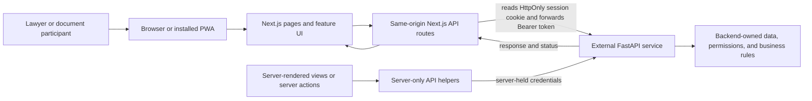
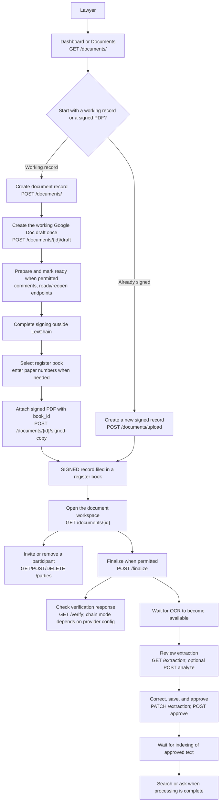
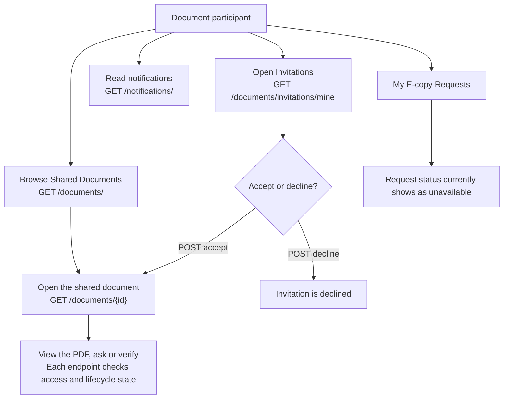

# Frontend and backend user-flow map

_Reviewed 2026-10-21._ This guide was reconciled with the frontend checkout and backend source commit `05f99cfdd5047bd8214fb328fb963b09704e80a2`. The backend source includes the signed-copy file and failed-processing retry routes described below. The frontend OpenAPI file and generated types are snapshots, not runtime validation. No authenticated deployed workflow was run. Source paths and line references for the backend design are in the [whole-system architecture](ARCHITECTURE.md).

## In brief

LexChain is a Next.js web application that can be installed as a PWA. It gives lawyers and document participants different portal navigation. The application sends authenticated requests to a separate FastAPI service. The frontend presents workflows and validates inputs at selected boundaries; the backend owns document records, persistence, authorization, lifecycle rules, processing, and verification.

## How a request moves through the system

Browser requests normally go to the LexChain origin first. The shared GET proxy is `/api/portal/proxy`; the mutation proxy handles POST, PUT, PATCH, and DELETE at `/api/portal/proxy-post`. Authentication, signup, participant access, and some administrative operations also use dedicated route handlers. Server-rendered pages and server actions can use server-only backend helpers directly.

After sign-in, the Next.js route stores the backend token in HttpOnly cookies. Browser JavaScript uses the same-origin routes and does not need to read the bearer token. A readable role hint helps select the right navigation, but it is not an authorization check. The backend remains responsible for deciding whether a request is allowed.

The backend URL is configured with `API_URL` or `NEXT_PUBLIC_API_URL`. The frontend does not own a second database or a second copy of the document lifecycle rules.

## Signing in and choosing a portal

1. A person signs in from `/login`. The browser posts to `/api/auth`, which forwards credentials to the backend sign-in operation.
2. The response establishes the local portal session cookies and includes the account role.
3. The backend has two account roles: `lawyer` and `user`. The frontend maps legacy/UI aliases (`document_issuer`, `admin`, `super_admin`) to Lawyer navigation and `document_participant` to User navigation; these aliases do not add backend permissions.
4. Lawyers land on `/portal/dashboard`; participants land on `/portal/documents`. Unsupported roles see an access-unavailable message.
5. Signing out calls the portal logout route. The server attempts backend sign-out and clears the local session cookies even if the backend cannot be reached.

These mappings control presentation only. Backend authorization checks the local account role and the individual document relationship. There is no separate backend administrator tier; lawyer accounts also pass the `/admin/*` router's lawyer-role checks. [Sources: `src/features/access/portal-role.ts:8–18`; backend `backend/app/shared/constants.py:16–27`, `backend/app/infrastructure/security/dependencies.py:159–165`, `backend/app/features/admin/router.py:13–26` at commit `05f99cfdd5047bd8214fb328fb963b09704e80a2`.]

| User action | Frontend route | Backend endpoint |
|---|---|---|
| Sign in | `/login` → `/api/auth` | `POST /auth/signin` |
| Create an account | `/register` → `/api/portal/signup` | `POST /auth/signup` |
| Resend verification | Signup/verification UI → `/api/portal/resend-verification` | `POST /auth/resend-verification` |
| Load the account profile | Portal UI → `/api/portal/proxy` | `GET /users/`; sign-in response is the primary role source |
| Sign out | `/api/portal/logout` | `POST /auth/signout`, then local cookies are cleared |

## Overall end-to-end use case

The [compact use-case flow](lexchain-usecase-flow.md) shows the complete journey from account access through lawyer/client roles, filing, finalization, and search. The sections below expand the lawyer and client steps into frontend routes and backend operations. Evidence is based on this frontend checkout and backend source commit `05f99cfdd5047bd8214fb328fb963b09704e80a2`; it does not prove authenticated deployed execution.

### Why the flow has these boundaries

- Backend account role and document access answer different questions. A pending invitation grants no access; an accepted party can read only the shared document and cannot perform owner mutations. A regular client (`user`) can be invited as a `viewer`; assigning `signer` or `editor` requires the invited account itself to have the backend `lawyer` role. These are document-party roles, not global account roles. This protects one lawyer’s records from writes by other accounts. [Backend source: `backend/app/features/documents/workflow/sharing.py:48–77`.]
- Google Docs is the collaboration draft. The signed PDF is the filing and integrity artifact. Finalization fingerprints that PDF before OCR review, so corrections to extracted text do not change the signed-copy fingerprint.
- Finalization and text processing are separate. Finalization can succeed while OCR or indexing remains pending or fails. The dispatch record commits with document state before Celery processing runs.

## A lawyer’s document workflow

The lawyer’s portal navigation includes the dashboard, documents, books, categories, reports, user accounts, issuer invitations, audit logs, and office settings.

The route map below pairs user actions with frontend and backend operations. A call path in source does not guarantee that the deployed backend succeeds for every record. The workspace loads available books for signed-copy attachment; closed books require the paper register’s document and page numbers, while open books can allocate an entry or accept manual numbers. [Sources: frontend `src/features/documents/components/document-workspace.tsx:104–117,380–397`; backend `backend/app/features/documents/workflow/intake.py` and `backend/app/features/documents/router.py`.]

| Step | Frontend page/action | FastAPI endpoint(s) |
|---|---|---|
| Open dashboard and document list | `/portal/dashboard`, `/portal/documents` | `GET /documents/`; dashboard metrics also use `GET /admin/dashboard`, which still requires the backend `lawyer` role |
| Create a working record | Documents → Create document draft | `POST /documents/` |
| Connect Google and create/select a working draft | `/portal/profile/account`, document workspace | `GET /google/connection`, `POST /google/connect`, `GET /google/picker-token`, `POST /documents/{document_id}/draft`; callback is redirect-driven |
| Read and sync draft comments | Document workspace | `GET /documents/{document_id}/comments`, `POST /documents/{document_id}/comments/sync` |
| Mark ready or reopen | Document workspace | `POST /documents/{document_id}/ready`, `POST /documents/{document_id}/reopen` |
| Cancel an unsigned record | Document workspace | `POST /documents/{document_id}/cancel`; only PREPARING or READY_FOR_SIGNATURE |
| Upload a signed PDF to a book | `/portal/upload` | `GET /books/`, `POST /documents/upload` |
| Attach, replace, or review signed-copy history | Document workspace | `POST /documents/{document_id}/signed-copy`, `PUT /documents/{document_id}/signed-copy`, `GET /documents/{document_id}/signed-copies` |
| View or download a signed PDF | Document viewer/workspace → `/api/portal/documents/{id}/file` | `GET /documents/{document_id}/file` returns a short-lived signed URL; the Next.js route streams the PDF |
| Retry failed processing | Document workspace when the owner has `can_retry_processing` | `POST /documents/{document_id}/retry-processing` returns 202 and queues the failed phase without repeating finalization |
| Read or rename a document | Document workspace | `GET /documents/{document_id}`, `PATCH /documents/{document_id}` |
| Correct register details or read lifecycle history | Document workspace | `PATCH /documents/{document_id}/entry`, `GET /documents/{document_id}/history` |
| Review extracted text when available | `/portal/documents/{id}/review` | `GET /documents/{document_id}/extraction`, `POST /documents/{document_id}/extraction/analyze`, `PATCH /documents/{document_id}/extraction`, `POST /documents/{document_id}/extraction/approve` |
| Invite or remove a document participant | `/portal/documents/{id}/participants` | `GET /documents/{document_id}/parties`, `POST /documents/{document_id}/parties`, `DELETE /documents/{document_id}/parties/{party_user_id}` |
| Finalize and verify | Document workspace, `/portal/documents/{id}/verify` | `POST /documents/{document_id}/finalize`, `GET /documents/{document_id}/verify` |
| Search documents or ask about one | `/portal/search`, document workspace Search tab, `/portal/documents/{id}/ask` | `POST /search`, `POST /documents/{document_id}/search`, `POST /documents/{document_id}/ask` |
| Disconnect Google | `/portal/profile/account` | `DELETE /google/connection`; existing drafts remain in Drive |

The two entry paths are different: a Google Doc is an editable working draft, while a signed PDF is the legal copy filed in the document workflow. The draft panel describes the Google document as separate from the signed PDF. Uploading a signed PDF asks the lawyer for a title and book; closed books can also require paper register numbers.

The backend source fixes the processing order: a SIGNED record is finalized and its PDF hash is sent to the configured blockchain provider before OCR review; approved text is then queued for indexing. The source does not prove a production provider writes on-chain: outside `ENVIRONMENT=development`, the factory selects the mock. The UI shows actions using returned permissions and status. Uploading through `/documents/upload` creates a new record; attaching through `/documents/{document_id}/signed-copy` preserves the prepared record after the lawyer selects a register book.

The document workspace provides actions such as viewing the record, opening the PDF, asking questions about the document, reviewing available extracted text, managing participants, and checking verification. Which lifecycle actions appear depends on the returned document state and permissions. The backend response is authoritative; the screen should not assume every document follows the same sequence.

Books, categories, reports, and office settings appear in the lawyer’s office navigation, but they do not all persist through the backend. Books use backend operations to list, create, open, close, and delete registers; backend state and permissions determine whether a mutation succeeds. Categories, reports, and office settings currently use demo/local state. Their pages may call `GET /users/` to identify the current role, but that profile request does not persist those page changes.

| Office action | Frontend page | FastAPI endpoint(s) |
|---|---|---|
| List, create, or open a register book | `/portal/books` | `GET /books/`, `POST /books/`, `GET /books/{book_id}` |
| Close or delete a book | `/portal/books` | `POST /books/{book_id}/close`, `DELETE /books/{book_id}` |
| Review admin dashboard and users | Portal dashboard and `/portal/users` | `GET /admin/dashboard`, `GET /admin/users`, `PATCH /admin/users/{user_id}/active` |
| Create or revoke issuer invitations | `/portal/issuer-invitations` | `GET /admin/invitations`, `POST /admin/invitations`, `DELETE /admin/invitations/{invitation_id}` |
| View or edit categories | `/portal/categories` | UI state only; no category CRUD operation in the checked-in OpenAPI contract. `GET /users/` is used for role gating. Changes reset on refresh. |
| Generate or download reports | `/portal/reports` | Local seeded demo data; no report-generation or persistence endpoint is called. |
| View or save office settings | `/portal/office-settings` | UI state only; `GET /users/` is used for role gating. Saves last for the demo session and reset on refresh. |
| Review document requests | `/portal/requests` | Unavailable UI state; no matching request-review endpoint is called. |

## A participant’s document workflow

The client (backend role `user`) portal starts at the shared-document list. Its navigation includes **Shared Documents**, **Invitations**, and **My E-copy Requests**. A client accepts an invitation to gain per-document view access; the UI's `document_participant` role is only an alias for this backend account role.

| User action | Frontend page/action | FastAPI endpoint(s) |
|---|---|---|
| List shared documents | `/portal/documents` | `GET /documents/` |
| View an invitation | `/portal/invitations` | `GET /documents/invitations/mine` |
| Accept or decline an invitation | Invitation action | `POST /documents/invitations/{invitation_id}/accept`, `POST /documents/invitations/{invitation_id}/decline` |
| Open a shared document | Document workspace | `GET /documents/{document_id}`; access is decided by the backend |
| View a signed PDF | Document viewer/workspace | Next.js `GET /api/portal/documents/{id}/file` → backend `GET /documents/{document_id}/file` |
| Ask a question or verify | Document workspace and document pages | `POST /documents/{document_id}/ask`, `GET /documents/{document_id}/verify`; backend access and status checks still apply |
| Read or mark notifications | Top bar and `/portal/notifications` | `GET /notifications/`, `GET /notifications/unread-count`, `PATCH /notifications/{notification_id}/read`, `PATCH /notifications/read-all` |
| View e-copy request status | `/portal/requests/my` | No matching request-status operation appears in the current OpenAPI contract; the page shows an unavailable state |

The invitation screen lets a client accept or decline an invitation. A pending invite does not expose the document; accepting grants access to that document only. Clients do not own lifecycle actions such as editing register data, replacing a signed copy, finalizing, or approving extraction. The lawyer handles physical signing and uploads the signed scan.

The **My E-copy Requests** screen currently displays that request status is unavailable. The lawyer’s **Document Requests** screen likewise says request review is unavailable. Those screens should not be read as evidence that e-copy request submission and review are fully connected.

### Frontend callers verified in source

The following additional contract operations have frontend call paths in the 2026-10-20 checkout; these establish source wiring, not live success:

| Backend operation | Frontend caller |
|---|---|
| `GET /users/search` | Participant invitation form via `searchUserByEmail` in [access API helpers](../src/features/access/portal-access-api.ts) |
| `POST /documents/{document_id}/cancel` | Document detail page via `cancelDocument` in [lifecycle API helpers](../src/features/documents/document-lifecycle-api.ts) |
| `PATCH /documents/{document_id}/entry` | Document workspace register correction via `correctDocumentEntry` in lifecycle API helpers |
| `GET /documents/{document_id}/history` | Document workspace History tab via `listDocumentHistory` in lifecycle API helpers |
| `POST /documents/{document_id}/search` | Document workspace Search tab via `searchDocument` in [search API helpers](../src/features/documents/search-api.ts); global search separately uses `POST /search` |
| `DELETE /google/connection` | Disconnect action in [the account page](../src/features/account/pages/profile-account-page.tsx) |

`GET /google/callback` is called by Google during OAuth, without a bearer token, and redirects to the configured app URL with the connection outcome. The account route reads those query parameters and displays the result. No direct frontend fetch is expected; configured redirects and successful consent still require runtime verification.

The document activity screen calls `/documents/{document_id}/audit-logs`, and frontend handlers also forward to `/admin/audit-logs` and legacy `/blockchain/record/{id}`. These routes are not implemented by the reviewed backend source. The backend document router is mounted, but the separate blockchain router is commented out; the source-supported document flow is `POST /documents/{document_id}/finalize` then `GET /documents/{document_id}/verify`. Do not treat the frontend routes as backend support. [Backend source at `05f99cfdd5047bd8214fb328fb963b09704e80a2`: `backend/app/main.py`; `backend/app/features/documents/router.py`; `backend/app/features/blockchain/router.py`.]

## Optional Google document flow

Where Google is connected and the required Picker configuration is available, a lawyer can create a blank Google Doc, copy a template, or select an existing Google Doc for a working draft. The user edits that draft in Google. LexChain keeps the draft link separate from the signed PDF and uses backend operations for draft and comment synchronization. Google availability and setup can affect this path.

## What happens when the network is unavailable

The PWA uses the same web routes as the browser version. Its service worker caches only the static offline fallback. Document data, authenticated pages, uploads, and API responses are not available offline, and the app does not queue document mutations for later.

For local demo checks, both `NEXT_PUBLIC_USE_MOCK_API` and `USE_MOCK_API` need to be enabled. Mock accounts and responses are local fixtures; they do not establish that the real backend is reachable or behaves the same way.

Mock mode uses synthetic document, signed-copy, and verification fixtures. Its hashes, anchor details, and tamper results are simulated; they do not prove backend storage, processing, or blockchain behavior.

## Boundaries and limits

- The OpenAPI contract describes backend paths, request shapes, and declared responses. An operation in the contract does not by itself prove that a screen calls it or that the deployed service responds as declared.
- The frontend source shows the Next.js routes, role-specific screens, and request adapters. The backend implementation is maintained separately.
- Backend source is needed for internal workflows and authorization. Its presence does not prove which environment configuration, storage policy, provider, or worker processes are active in deployment.
- Some screens intentionally show unavailable states when the contract or a working integration is missing. The e-copy request screens are a current example.
- The local generated API types are compile-time help; they do not validate every response at runtime.

Backend source at commit `05f99cfdd5047bd8214fb328fb963b09704e80a2` defines `GET /documents/{document_id}/file` and `POST /documents/{document_id}/retry-processing`. Compare the checked-in OpenAPI snapshot with current backend source before changing contract-dependent code. No live `/docs` or `/openapi.json` endpoint, authenticated request, or deployed document journey was checked for this review.

## Useful references

- [Step-by-step manual testing guide](MANUAL-TESTING-GUIDE.md)
- [Repository setup and API configuration](../README.md)
- [Frontend/backend ownership and boundaries](ARCHITECTURE.md)
- [Current integration review](BACKEND-FRONTEND-INTEGRATION-AUDIT.md) — a dated review snapshot; re-check the live contract and source before using it as current status
- [Checked-in OpenAPI contract](../openapi-updated.json)
- [Portal navigation and role mapping](../src/features/portal/portal-dashboard.ts)
- [Role mapping and landing routes](../src/features/access/portal-role.ts)
- [Sign-in and session cookies](../src/app/api/auth/route.ts)
- [Authenticated GET proxy](../src/app/api/portal/proxy/route.ts)
- [Authenticated mutation proxy](../src/app/api/portal/proxy-post/route.ts)
