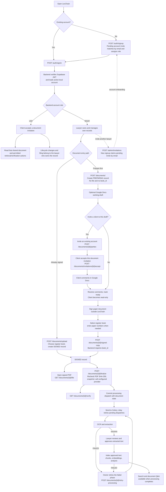

# LexChain use-case flow

_Reviewed 2026-10-21._ This diagram combines frontend behavior with backend source at commit `05f99cfdd5047bd8214fb328fb963b09704e80a2`. It does not establish successful authenticated or deployed behavior. See the [detailed lawyer and client route map](USER-FLOW-ARCHITECTURE.md) and [whole-system architecture](ARCHITECTURE.md).

## Why the flow is separated

- **Account invitations and document invitations are separate.** A pending lawyer account invitation may assign the invited role by matching the new signup email; it does not grant access to a document. A document-party invitation requires a separate accept action and grants access only to that document. The web signup does not submit or validate the invitation token. See the [detailed invitation flow](USER-FLOW-ARCHITECTURE.md#lawyer-account-invitations-are-not-document-party-invitations).
- **Account role and document access answer different questions.** Backend roles are only `lawyer` and `user`; accepted `DocumentParty` membership grants a client access to one document. A pending invitation grants no access, and an accepted party cannot run owner mutations. A `user` can be invited as a viewer; signer/editor party roles require a lawyer account. Frontend aliases such as `admin` and `document_participant` affect navigation only.
- **The working draft and signed copy serve different purposes.** Google Docs supports preparation and comments. The signed PDF is filed and fingerprinted. OCR corrections happen after finalization and do not change that PDF fingerprint.
- **Finalization is not the same as processing completion.** Finalization checks the stored PDF, snapshots it, calls the configured provider, and records an asynchronous dispatch. OCR and indexing continue after the request commits, so they can remain pending or fail independently.
- **The chain result depends on deployment configuration.** The backend factory chooses Web3 only for `ENVIRONMENT=development` and a mock otherwise. Source code does not prove that a deployed environment writes hashes on-chain.

## Source map

Backend source paths are relative to the separate `lexchain-backend` repository:

- Account roles and request authorization: `backend/app/shared/constants.py:16–27`; `backend/app/infrastructure/security/dependencies.py:66–149,159–165`; `backend/app/features/documents/access.py:41–82`.
- Invitations and draft permissions: `backend/app/features/documents/workflow/sharing.py:48–119,156–196`; `backend/app/features/documents/workflow/drafting.py:45–53,72–122`.
- Lawyer account invitations and signup role assignment: `backend/app/features/admin/service.py:104–174`; `backend/app/features/auth/schemas.py:14–19`; `backend/app/features/auth/service.py:144–154`; `backend/app/features/users/repository.py:61–82`; `backend/app/features/admin/repository.py:21–29`.
- Both intake paths and the required register entry: `backend/app/features/documents/workflow/intake.py:61–206`; `backend/app/features/documents/router.py:113–168,365–385`.
- Finalization, dispatch, extraction and enrichment: `backend/app/features/documents/workflow/finalization.py:42–108`; `backend/app/features/documents/dispatch.py:23–79`; `backend/app/workers/process_documents.py:35–152,155–236`.
- Provider selection: `backend/app/features/blockchain/dependencies.py:7–11`.
- Signed-copy file and retry routes: `backend/app/features/documents/router.py:423–440,703–728`; retry is available only to the owner of a FAILED document and resumes the failed processing phase without re-finalizing.
- Frontend prepared-record create/attach behavior: `src/features/documents/pages/documents-page.tsx:61`; `src/features/documents/components/document-workspace.tsx:104–117,380–397`.

Backend source at commit `05f99cfdd5047bd8214fb328fb963b09704e80a2` defines `GET /documents/{document_id}/file` for short-lived signed PDF access and `POST /documents/{document_id}/retry-processing` for retrying failed work. The frontend OpenAPI contract is a snapshot and may lag backend source. No authenticated workflow or worker/provider deployment was exercised; see the [architecture guide](ARCHITECTURE.md) for evidence limits.
